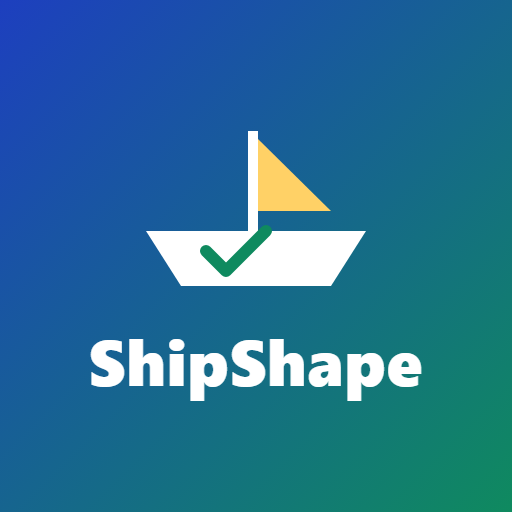
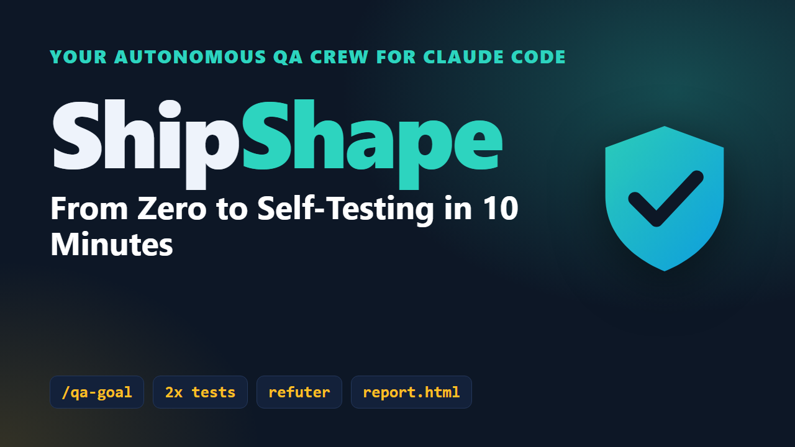
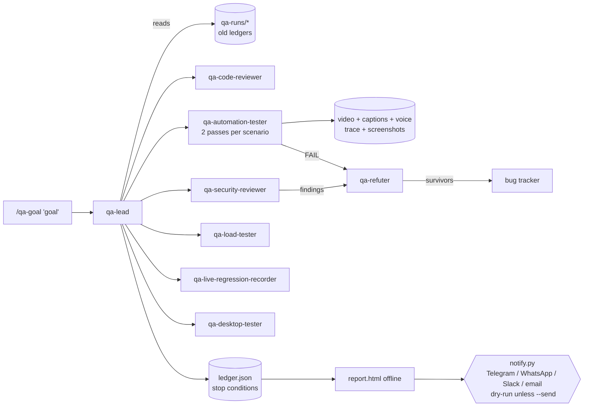

<p align="center"></p>

# ShipShape: your autonomous QA crew

**ShipShape is a Claude Code plugin that turns a plain sentence into a recorded, verified QA pass.**
Tell it `/qa-goal "a new user can sign up and reach checkout"`. A team of agents plans the scenarios and reviews the code and security. They run every test twice in a real browser and record narrated videos. They try to disprove each failure before filing it, re-test after fixes, and hand you an offline HTML report. The report can also go to Telegram, WhatsApp, Slack or email.

It also ships a **timesheet agent**, which measures real working hours from Claude Code logs, and an **Odoo expert** with safe staging and deploy rules.

## 🎬 Tutorial: *ShipShape — From Zero to Self-Testing in 10 Minutes*

<p align="center">
  <a href="https://github.com/Shadysmetools/shipshape/releases/latest/download/shipshape-tutorial.mp4">
    
  </a><br>
  <b>▶ Click the picture to watch the full tutorial (8½ min, MP4)</b> · <a href="https://github.com/Shadysmetools/shipshape/releases/latest/download/shipshape-teaser.mp4">60-second teaser</a> · <a href="https://github.com/Shadysmetools/shipshape/releases/tag/v0.1.0">all videos</a>
</p>

<p align="center"></p>

What the tutorial covers (8½ minutes), in order: what ShipShape is (0:13) · the rules it never breaks (0:37) · install in 5 steps (0:54) · `bin/doctor` health check (1:17) · your first `/qa-goal` (1:41) · agents and rounds (2:33) · narrated video evidence (3:10) · load test (3:33) · live regression (3:53) · the refuter (4:34) · the HTML report and old runs (5:12) · delivery to Telegram/WhatsApp (5:48) · plain-language hooks (6:13) · desktop control (6:51) · timesheet agent (7:24) · Odoo expert (7:51) · getting help (8:15).
Written version: [QUICKSTART.md](QUICKSTART.md) · full walkthrough: [docs/GUIDE.md](docs/GUIDE.md) · **[For buyers](docs/FOR-BUYERS.md)** · [Team setup](docs/TEAM-SETUP.md) · re-render the video yourself: `bin/make-video.sh tutorial`.

---


## What you get

| Capability | What it does | Entry point |
|---|---|---|
| Goal loop | Plans, runs, verifies, refutes, files bugs and re-tests until the goal is met or a stop condition hits. A durable ledger means a restart loses nothing. | `/qa-goal`, `scripts/qa_loop.py` |
| Automated tests, twice | Each scenario runs as two independent Playwright passes. If the passes disagree, the result is **FLAKY**, never a pass. | `qa-automation-tester`, `record.py` |
| Narrated video evidence | Native Playwright video with a caption bar, a natural voice (edge-tts, EN/AR), `.srt` captions, a trace and screenshots. | `/qa-record` |
| Code + security review | A read-only reviewer, plus an OWASP-style security reviewer (secrets, dependency audit, headers/cookies/CORS). Only finding *counts* ever leave the machine. | `/qa-security` |
| Load testing | Ramp, soak and spike profiles with p95/p99/error-rate thresholds and a chart, on allow-listed hosts only. A k6 template is included. | `/qa-load` |
| Live regression | Read-only flows on staging/live, with Chrome DevTools console, network and performance evidence on failure. | `qa-live-regression-recorder` |
| Refuter | A second agent tries to kill every failure and finding before it is filed (the two-agent bar). | `qa-refuter` |
| Offline HTML report | Pass/fail table, video players, screenshots, console/network, bugs, load and security summaries, and a trend across old runs. | `/qa-report` |
| Learns from old runs | Reads earlier ledgers for trend, flaky cases, open bugs and re-checks before planning. | `scripts/qa_history.py` |
| Auto-delivery | Telegram, WhatsApp (Meta or Twilio), Slack, email and webhooks, configured per project. Dry-run by default, and secrets come from env vars only. | `/qa-deliver` |
| Voice narrator | Spoken run summaries for non-technical people, narration under any video (with ducking), and slide videos from screenshots. | `scripts/narrator.py` |
| Demo videos | Polished feature demos and tutorials. | `/qa-demo` |
| Desktop control | Native apps, OS dialogs and Electron apps on Windows/macOS. Uses Claude computer use when available, otherwise pywinauto/pyautogui/osascript. Gated, recorded and logged. | `qa-desktop-tester` |
| Plain-language hooks | Safety rules written in English and judged by a model. For example: "never just say all green", "no Odoo writes without the owner's OK", "no sends to unlisted channels". | `hooks/hooks.json` |
| Timesheet | Hours measured from session logs and git, mapped to tasks. Produces a 7-sheet Excel file and Odoo import rows, with self-checks. | `/timesheet` |
| Odoo expert | Module conventions, guarded migrations, `neutralize.sql`, the Odoo.sh flow and a pre-deploy checker. | `/odoo-check` |

## How it fits together



Two layers do the work:
- **Scripts** (`scripts/*.py`) are deterministic and tested. They record, count, enforce guards and timeouts, and keep the ledger.
- **Agents, skills, commands and workflows** supply the judgement: what to test, is this failure real, what to file. They call the scripts.

## Install (about 20 minutes on a first install, mostly the Chromium download; about 5 minutes when Playwright and Chromium are already on the machine)

Requirements: [Claude Code](https://code.claude.com), Python 3.10+, Node.js 20+, ffmpeg. The installer handles everything else: Python packages, Chromium (about 150 MB), the pinned MCP servers. Firefox and WebKit are optional (`--with-browsers` / `-WithBrowsers`, about 250 MB more).

```bash
git clone https://github.com/Shadysmetools/shipshape.git && cd shipshape
bash bin/install.sh                 # macOS / Linux / Git Bash
# Windows PowerShell: powershell -ExecutionPolicy Bypass -File bin\install.ps1
bash bin/doctor.sh                  # verify: python, node, ffmpeg, Playwright browsers, MCP servers, voice
```

Then, inside Claude Code:
```
/plugin marketplace add Shadysmetools/shipshape
/plugin install smetools-agent-kit@shipshape
```
Two names, on purpose: **`shipshape`** is the GitHub repo and the marketplace you add; **`smetools-agent-kit`** is the plugin id inside it (the one you install, and the prefix of its skills: `smetools-agent-kit:qa-goal-loop`).
You can also add the marketplace from a local folder: `/plugin marketplace add /path/to/shipshape`, or pin a branch or tag with `#ref` (`/plugin marketplace add <your-org>/shipshape#team/<name>`). Teams: see [docs/TEAM-SETUP.md](docs/TEAM-SETUP.md) for the fork, update and contribute-back flow.

Installing the plugin wires up the agents, skills, slash commands and hooks. It also adds two MCP servers: **Playwright MCP** (`@playwright/mcp@0.0.83`, video/tracing enabled, isolated profile) and **Chrome DevTools MCP** (`chrome-devtools-mcp@1.10.1`). No keys are needed for either.

## First run (about 6 minutes, no account needed)

```bash
bash bin/run-qa.sh demo            # Windows: powershell -File bin\run-qa.ps1 demo   (or: bin\qa.cmd demo)
```
This serves the bundled demo shop on `127.0.0.1:8765` with fake data only, then runs the whole pipeline:

1. reads old runs;
2. runs a security scan;
3. runs the sign-up scenario twice with a narrated video;
4. runs a smoke load test;
5. builds the report;
6. does a Telegram/Slack delivery **dry-run**.

Open `qa-runs/<date>-demo-shop-sign-up-works/report.html`.

In Claude Code, the same flow happens from plain requests:
- "test the signup flow on http://127.0.0.1:8765 and record it"
- `/qa-goal "sign-up works in English"`
- "log my hours for project X this week" (`/timesheet`)
- "check this Odoo module before deploy" (`/odoo-check`)

## Commands

| Command | Use |
|---|---|
| `/qa-goal "<goal>"` | The full autonomous loop. |
| `/qa-run` | One pass of the scripted pipeline. |
| `/qa-record` | Record one scenario. |
| `/qa-load <url> [profile]` | Load test. |
| `/qa-security` | Security review. |
| `/qa-demo <feature>` | Demo video. |
| `/qa-report` | HTML report and spoken summary. |
| `/qa-deliver` | Send to the configured channels (dry-run first). |
| `/qa-setup` | Setup interview: project, voice, channels, your own keys. |
| `/qa-issue "<title>"` | File a ShipShape bug from any session: privacy-filtered, dry-run preview, filed only after you say yes. |
| `/timesheet` | Measured hours, Excel and Odoo rows. |
| `/odoo-check <module>` | Pre-deploy checks. |

Shell equivalents live in `bin/`. Each has a `.sh` and a `.ps1` version: `install`, `doctor`, `run-qa`, `make-video`, `send-report`, plus `qa` / `qa.cmd`.

## Configure a project

Copy `templates/qa.config.example.yaml` to your project as `qa.config.yaml`. It sets:
- `base_url` and `allow_hosts` (everything else is blocked);
- `live: true` for production sites (the run stops before any input);
- the narrator voice and language;
- the loop limits;
- the delivery channels (each one names the **env var** holding its secret);
- `issues.repo`: where `/qa-issue` files ShipShape bugs (default `Shadysmetools/shipshape`);
- desktop control (`desktop.enabled`, `allow_apps`).

## Safety, by design

- **Test data only.** **Never pays**: payment steps are refused. **Stops before input on live sites.** Hosts that are not allow-listed are blocked at the network layer.
- **Evidence or it didn't happen.** A PASS without evidence counts as BLOCKED. Results are always reported as `N pass / M fail / K flaky / B blocked`.
- **Privacy filter** (`scripts/privacy.py`) masks names, emails, phones, tokens and user paths before anything is uploaded. The deny-list of private names lives outside the repo.
- **Two-agent bar.** Nothing is filed until a verifier reproduces it and a refuter fails to kill it.
- **Owner approval.** Writes to Odoo or production, outward sends and irreversible desktop actions all need the owner's words in the conversation. A relayed "they approved" does not count. Plain-language hooks enforce this, and the scripts enforce the hard limits themselves.
- **Timeouts everywhere**: per step, per run, per round and per hook.

Read more in `docs/OPERATING-RULES.md`, `docs/HOOKS-IN-PLAIN-LANGUAGE.md` and `docs/BROWSERS.md` (which browser for what).

## For buyers

What ShipShape does for a client, the install path, support boundaries and the (placeholder) tiers: [docs/FOR-BUYERS.md](docs/FOR-BUYERS.md). ShipShape provides no API keys or third-party accounts; each user supplies their own, stored only on their computer. License options are compared in [LICENSE-OPTIONS.md](LICENSE-OPTIONS.md); the owner picks one. Contributions: [CONTRIBUTING.md](CONTRIBUTING.md).

## Tests

```bash
python -m pytest            # runs tests/ (pytest.ini)
```
Last run on Windows 11 (Python 3.12, Playwright 1.63, ffmpeg 7): **171 pass / 0 fail / 1 skipped** (172 collected). The skipped test is the real-desktop smoke test, which only runs with `SMEKIT_DESKTOP_SMOKE=1` so CI never controls a desktop.

The suite covers:
- timesheet measurement, including a mutation-proven regression test for the unsorted-timestamp bug that once produced negative hours;
- the privacy filter and the report counter (including FLAKY and the "all green" check);
- the loop's stop conditions, ledger resume and old-run reading;
- the HTML report;
- every notifier (mocked HTTP and dry-run);
- the load tester against a local server;
- the security wrappers;
- the narrator, the Odoo checker and the stack lock;
- the desktop gates (mock and dry-run);
- the plugin manifests and hooks;
- dry-runs of all three workflows with mocked agents;
- a real Playwright recording smoke test against the local page (external requests blocked);
- an end-to-end `full_qa.py` run on the example app;
- one acceptance test per P0 lesson in `docs/LESSONS-TO-BEHAVIOUR.md` (`tests/test_lessons_p0.py`);
- one regression test per fix from the 0.1.0 evaluation (`tests/test_eval_fixes.py`): `--url` beats the plan's URL and a dead target fails, one-line config and plan errors, narration surfaced on both passes, the offline narrator, the pinned installer, the deterministic hook guard (deny/ask), the demo wrapper.

## Verified vs not verified

| Item | Status |
|---|---|
| `claude plugin validate .` | passes |
| Marketplace add + plugin install in a clean, isolated Claude config | see `docs/INSTALL-PROOF.md` |
| Recording, narration, report, loop, load (native engine), security wrappers, timesheet, Odoo check | run here against the local example app |
| Real sends to Telegram/WhatsApp/Slack/email | **not run**; tested with mocked HTTP and dry-run only |
| k6 engine, gitleaks, pip-audit, osv-scanner | used when installed; not installed on the build machine, so only the "skipped" path is tested |
| Desktop control on a real desktop | gated smoke test, not run in CI |
| Prompt and agent hooks judged live by a model | JSON validated; the model's judgement is not unit-testable. The deterministic commit-scan hook is tested through its literal hooks.json command |
| `bin/run-qa.ps1 demo` on Windows | run here end to end: 2 pass / 0 fail, report, voice summary, dry-run delivery |
| `bin/install.sh` / `install.ps1` | syntax-checked; not executed end to end on a clean machine |
| macOS | **untested**. Scripts are written for it (avfoundation, osascript, a venv fallback for PEP 668 Python), but nothing ran on a Mac. Stock macOS has no `python` command: use the installer's venv or put a `python` on PATH |

## Repository layout
```
.claude-plugin/    plugin.json, marketplace.json
.mcp.json          Playwright MCP + Chrome DevTools MCP (pinned)
agents/            qa-lead, qa-code-reviewer, qa-security-reviewer, qa-automation-tester, qa-load-tester,
                   qa-live-regression-recorder, qa-desktop-tester, qa-demo-video-producer, qa-refuter,
                   timesheet-agent, odoo-expert
commands/          /qa-goal /qa-run /qa-record /qa-load /qa-security /qa-demo /qa-report /qa-deliver /qa-setup /qa-issue
                   /timesheet /odoo-check
skills/            progressive-disclosure SKILL.md per capability
hooks/hooks.json   plain-language prompt/agent hooks + two command hooks
workflows/         full-qa, demo, regression-loop (Claude Code Workflow scripts)
scripts/           the tested Python layer
bin/               install / doctor / run-qa / make-video / send-report (.sh + .ps1), qa, qa.cmd
templates/         test plan, bug report, bug log, handoff, qa.config, plan, tasks, load (k6), odoo/
examples/demo-app/ a local demo shop (fake data), plans, qa.config.yaml
docs/              GUIDE, OPERATING-RULES, BROWSERS, HOOKS-IN-PLAIN-LANGUAGE, TIMESHEET-METHOD, ODOO-PLAYBOOK,
                   SCHEDULED-MODE, SECURITY-SCAN, LESSONS-LEARNED, TEAM-SETUP, FOR-BUYERS, media/
```

## FAQ
- **Do I need API keys?** No. Narration uses free edge-tts voices. OpenAI or ElevenLabs voices and the delivery channels are optional. When one needs a key that isn't set, ShipShape asks for it in a masked window (or a hidden terminal prompt) and saves it on your computer only: the OS keychain if `keyring` is installed, otherwise `~/.config/shipshape/secrets/keys.json`. Env vars still win. Manage keys with `python scripts/keys.py set|check|list|delete`; set `SMEKIT_NO_PROMPT=1` for unattended runs.
- **Will it touch my production site?** Only read-only flows, and only if you allow-list the host. Any input on a site marked `live: true` stops and asks.
- **Arabic?** Set `narrator.lang: ar` (voices `ar-EG-ShakirNeural` / `ar-EG-SalmaNeural`). Delivery templates exist in EN and AR.
- **Scheduled runs?** Off by default. See `docs/SCHEDULED-MODE.md`.

See `QUICKSTART.md` for a 10-minute walkthrough and `docs/GUIDE.md` for the concepts. License: not chosen yet (`plugin.json` says `UNLICENSED`); the owner picks one before the public release. Options: [LICENSE-OPTIONS.md](LICENSE-OPTIONS.md).
